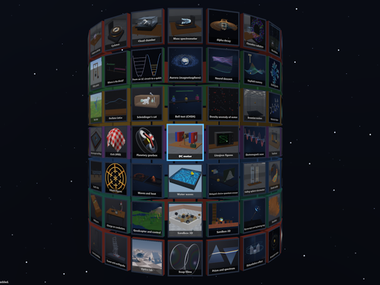
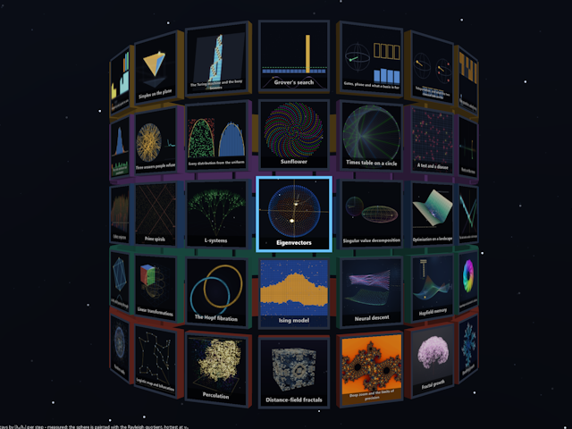
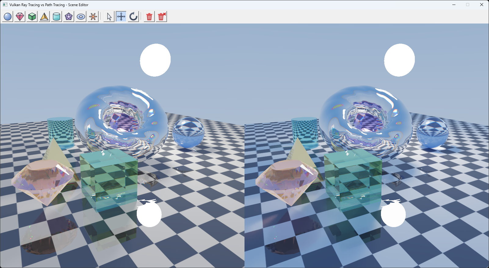
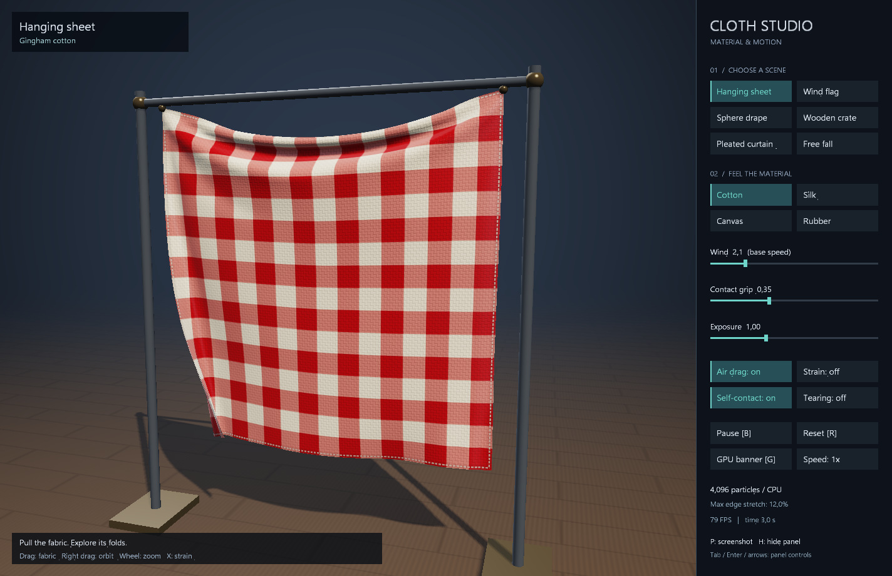
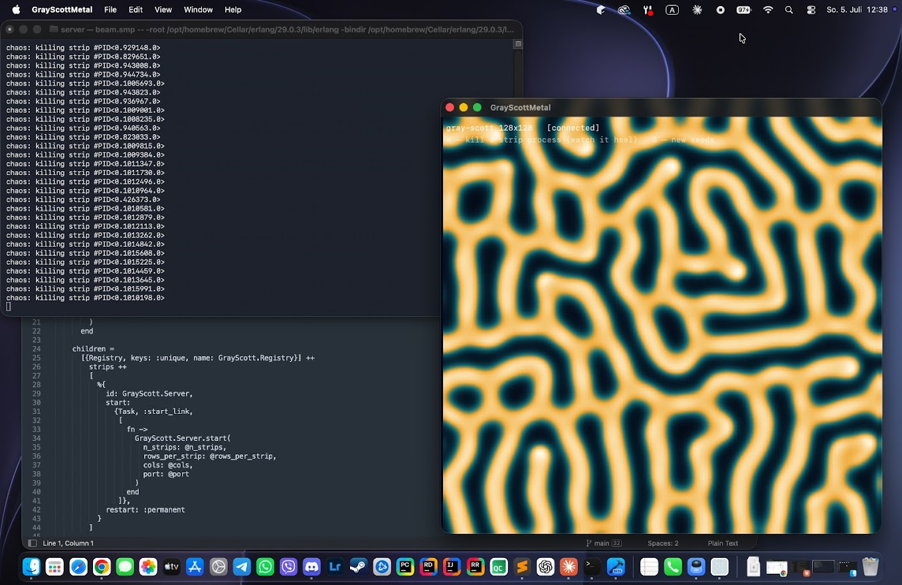
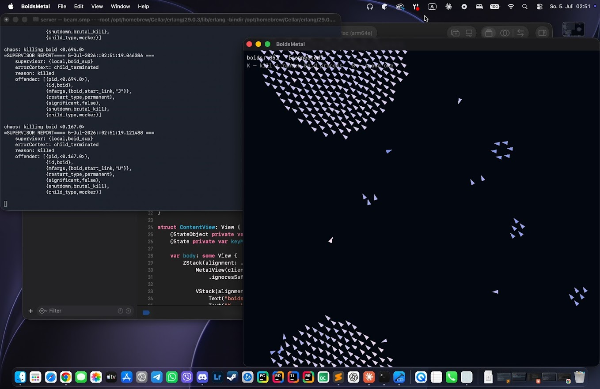
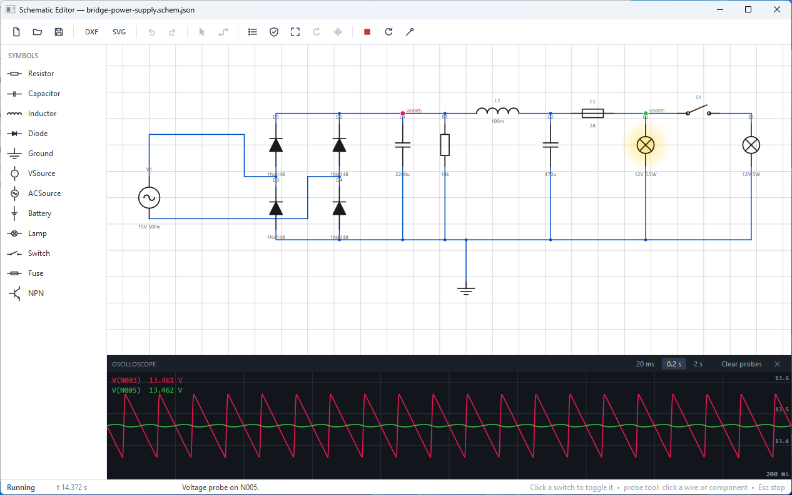

# Mykhailo Makarov (Michael Makarov)

**Senior .NET / C# Software Engineer. Munich, Germany.**
Enterprise backend, desktop applications, legacy modernization, and GPU physics simulation.

20 years of professional software development. I write production line-of-business systems in C# and .NET, and I have been writing real-time physics simulations on the GPU since 2004, first in Delphi and OpenGL, now in Vulkan, DirectX 12, Metal, and CUDA.

Open to remote positions across Germany and the EU, or hybrid in Munich.

---

## About me

I build software from the underlying algorithms to the finished product. Nearly 20 years of professional development have taken me through enterprise systems, legacy modernization, physics, graphics and infrastructure.

Enterprise development is my professional foundation: C#, .NET/.NET Core, ASP.NET Core, REST APIs, EF Core, LINQ, WPF/MVVM and WinForms. I work with MS SQL Server, T-SQL, database design, query tuning and integrations, alongside PostgreSQL and MySQL. My stack also includes Blazor Server/WebAssembly and Razor components, unit testing, CI/CD, Docker and Azure.

I modernize systems that businesses still rely on: Delphi/Object Pascal with InterBase, Firebird and ADO; .NET Framework, WinForms, WebForms and ASP.NET MVC. The work means understanding undocumented behavior, untangling business logic and data access, improving SQL performance, and moving components to modern .NET without disrupting daily operations.

Physics and computer graphics are a long-running personal pursuit. I build 2D/3D visualizations, renderers, ray/path tracers and physics engines from first principles: rigid bodies, fluids, particles, fields and numerical solvers. I use C#, C++, Rust and Swift with OpenGL, Vulkan, DirectX 12, Metal, CUDA/OpenCL and shaders; GDI+/Direct2D for 2D graphics, Python for numerical verification, and Erlang/Elixir for concurrent simulation experiments. I independently develop Makarov Suites: Physics and Math are available on Steam and Microsoft Store, Astronomy is available on Microsoft Store, and Earth and Engineering are in development.

I have built and administered my own Linux servers, configured Apache and deployed backend services. My infrastructure experience also includes Windows Server, IIS, Bash, PowerShell, Git and automated delivery. I use Node.js/JavaScript and Python for backend development, scripting and tooling, with experience in Java, Spring and Hibernate.

On the frontend, I work with Angular, TypeScript, JavaScript, HTML5, CSS, Sass/SCSS, Less and jQuery, from business interfaces and dynamic forms to interactive WebGL visualizations. At Artisteer, I worked on WYSIWYG editing, graphics and HTML/CSS generation for CMS themes.

My AI work includes Python/LLM prototypes at PACS to evaluate integration into existing business systems, and a convolutional neural network implemented from scratch in Rust. I also use AI tools in development, with code review, tests and numerical checks guiding what I ship.

Based in Munich; open to local or remote roles that value technical ownership, curiosity and depth.
[linkedin.com/in/makarov-mm](https://www.linkedin.com/in/makarov-mm)

---

Ich entwickle Software vom Algorithmus bis zum fertigen Produkt. Meine Erfahrung aus fast 20 Jahren Softwareentwicklung umfasst Enterprise-Systeme, Legacy-Modernisierung, Physik, Computergrafik und Infrastruktur.

Mein beruflicher Schwerpunkt ist die Enterprise-Entwicklung: C#, .NET/.NET Core, ASP.NET Core, REST-APIs, EF Core, LINQ, WPF/MVVM und WinForms. Dazu gehören MS SQL Server, T-SQL, Datenbankdesign, Abfrageoptimierung und Schnittstellen sowie PostgreSQL und MySQL. Mein Werkzeugkasten umfasst auch Blazor Server/WebAssembly, Razor-Komponenten, Unit-Tests, CI/CD, Docker und Azure.

Ich modernisiere gewachsene Systeme: Delphi/Object Pascal mit InterBase, Firebird und ADO sowie .NET Framework, WinForms, WebForms und ASP.NET MVC. Dabei erschließe ich undokumentiertes Verhalten, entflechte Geschäftslogik und Datenzugriffe, optimiere SQL und überführe Komponenten schrittweise in modernes .NET, während der laufende Betrieb erhalten bleibt.

Physik und Computergrafik begleiten mich seit vielen Jahren. Ich entwickle eigene 2D-/3D-Visualisierungen, Renderer, Ray-/Pathtracer und Physik-Engines: Starrkörper, Fluide, Partikel, Felder und numerische Solver. Dafür nutze ich C#, C++, Rust und Swift mit OpenGL, Vulkan, DirectX 12, Metal, CUDA/OpenCL und Shadern; GDI+/Direct2D für 2D-Grafik, Python zur numerischen Verifikation und Erlang/Elixir für nebenläufige Simulationsexperimente. Ich entwickle die Makarov Suites eigenständig: Physics und Math sind auf Steam und im Microsoft Store erhältlich, Astronomy ist im Microsoft Store verfügbar. Earth und Engineering befinden sich in Entwicklung.

Ich habe eigene Linux-Server aufgebaut und administriert, Apache konfiguriert und Backend-Dienste bereitgestellt. Hinzu kommen Windows Server, IIS, Bash, PowerShell, Git und automatisierte Deployment-Prozesse. Node.js/JavaScript und Python nutze ich für Backends, Skripte und Werkzeuge; Erfahrung habe ich auch mit Java, Spring und Hibernate.

Im Frontend arbeite ich mit Angular, TypeScript, JavaScript, HTML5, CSS, Sass/SCSS, Less und jQuery: von Geschäftsanwendungen bis zu interaktiven WebGL-Visualisierungen. Bei Artisteer arbeitete ich an WYSIWYG-Funktionen, Grafik und der HTML/CSS-Ausgabe für CMS-Themes.

Meine KI-Arbeit umfasst Python-/LLM-Prototypen zur Prüfung einer Integration in bestehende Systeme sowie ein selbst implementiertes Convolutional Neural Network in Rust. Ich nutze KI-Werkzeuge auch in der Entwicklung und prüfe die Ergebnisse mit Code-Reviews, Tests und numerischen Vergleichen.

Ich lebe in München und suche Aufgaben vor Ort oder remote, mit technischer Verantwortung, Gestaltungsspielraum und fachlicher Tiefe.
[linkedin.com/in/makarov-mm](https://www.linkedin.com/in/makarov-mm)

---

## What I do

**Enterprise backend**
C#, .NET / .NET Core, ASP.NET Core, REST APIs, Entity Framework Core, MS SQL Server, PostgreSQL, background services, integrations, domain modeling, unit and integration testing.

**Desktop applications**
WPF with MVVM, WinForms, custom controls, data-heavy UI, hardware-accelerated rendering embedded in business applications.

**Legacy modernization**
Delphi to .NET migration, .NET Framework to .NET Core, strangler-fig refactoring of monoliths, replacing undocumented systems while keeping them running in production.

**Graphics and GPU compute**
Vulkan, DirectX 12, OpenGL, Metal, CUDA, compute shaders, hardware ray tracing, GPU particle systems, real-time numerical integration, render pipeline architecture.

**Numerical simulation**
Fluid dynamics, N-body gravitation, rigid body dynamics, finite difference and spectral methods, reaction-diffusion systems, wave equations, Schrodinger evolution, verification against analytical solutions.

---

## Selected projects

I independently develop **Makarov Suites**, a family of interactive science applications built on a shared simulation and graphics codebase. The experiments run locally: change a parameter, work with the scene, and compare the result with measurements and plots.

[Website, screenshots and downloads](https://makarovphysics.com/)

| Product | Current catalogue | Availability |
|---|---|---|
| **Makarov Physics Suite** | 180 interactive modules · 9 rings of 20 | [Steam](https://store.steampowered.com/app/4861360/Makarov_Physics_Suite/) · [Microsoft Store](https://apps.microsoft.com/detail/9P23373JLGVF) |
| **Makarov Math Suite** | 160 interactive modules · 8 rings of 20 | [Steam](https://store.steampowered.com/app/5204230/Makarov_Math_Suite/) · [Microsoft Store](https://apps.microsoft.com/detail/9P5K9QRHHKKP) |
| **Makarov Astronomy Suite** | 120 interactive modules · 6 rings of 20 | [Microsoft Store](https://apps.microsoft.com/detail/9MWFBPB7TXHR); Steam release in preparation |
| **Makarov Earth Suite** | 80 entries · 23 working / 57 planned | In development |
| **Makarov Engineering Suite** | 160 entries · 53 working / 107 planned | In development |

Earth and Engineering are development projects. Their working counts include modules shared with the other Suites; the remaining catalogue entries are planned modules, not completed experiments.

The Windows applications use C# and .NET, an in-house module host and UI, a custom OpenGL renderer, and native CUDA, OpenCL or Vulkan computation in supported modules. The numerical models and rendering are developed without an off-the-shelf game engine. Each product's manifest selects its modules, carousel and resources; shared experiments use the same implementation across products.

Verification combines independent Python reference calculations, analytical solutions, conservation laws and numerical regression tests. Release checks cover product boundaries, localization, shaders, resources and packaging. Models document their assumptions and limits. A native macOS codebase in Swift and Metal is developed alongside Windows, with module coverage and visual parity tracked separately.

The interface is multilingual. Windows support includes Simplified Chinese, Japanese and Korean, bundled fonts and IME input. Translation depth varies by module; catalogue translations and complete experiment translations are tracked separately.

### Makarov Physics Suite

**180 interactive modules** covering mechanics, oscillations, fluids, waves, optics, electromagnetism, thermodynamics, quantum physics and nonlinear systems. Available on Steam and Microsoft Store.

The collection ranges from individual experiments to machines you can operate: guide a robot arm, drive a forklift, balance a platform, inspect an engine, explore airflow around obstacles or follow particles in electromagnetic fields. Detailed apparatus, cutaways, materials, lighting and camera controls make the mechanism visible while measurements show what the model is doing.

The numerical work includes rigid-body dynamics with joints and contacts, lattice-Boltzmann and SPH fluids, granular and continuum models, Barnes–Hut gravitation, FDTD electromagnetics, spectral quantum solvers and ray tracing. Selected fluid and particle modules support GPU computation; the available backends depend on the module and hardware.

[Steam](https://store.steampowered.com/app/4861360/Makarov_Physics_Suite/) · [Microsoft Store](https://apps.microsoft.com/detail/9P23373JLGVF) · [Website](https://makarovphysics.com/)

---

### Makarov Math Suite

**160 interactive modules in eight rings of twenty**, built on the same platform. Available on Steam and Microsoft Store.

The aim is to make mathematical structures something you can manipulate and measure: fold a sheet, change a transformation, explore a surface, follow an algorithm or watch a probability distribution form.

- **Geometry and topology:** origami, dissections, curves of constant width, polyhedron unfolding, Möbius strips, knots, non-orientable surfaces, 4D sections and the Hopf fibration.
- **Fractals and dynamics:** Mandelbrot and Julia sets, chaos, attractors, the logistic map, cellular automata and growth.
- **Analysis and linear algebra:** derivatives, integrals, Taylor approximations, Fourier analysis, eigenvectors, singular values, Gaussian elimination and least squares.
- **Probability and statistics:** Bayes, Monte Carlo, confidence intervals, the central limit theorem, Simpson's paradox, Benford's law and Buffon's needle.
- **Algorithms and discrete mathematics:** sorting and graph search, Dijkstra, mazes, string matching, compression, logic gates, finite automata and game trees.
- **Models and computation:** networks, queues, matching, game theory, Kalman filtering, clustering, cryptography and quantum-computing demonstrations.

The diagrams and 3D scenes are computed from the parameters. Exact identities and combinatorial results are checked alongside numerical approximations, with tolerances where the method requires them.

[Steam](https://store.steampowered.com/app/5204230/Makarov_Math_Suite/) · [Microsoft Store](https://apps.microsoft.com/detail/9P5K9QRHHKKP) · [Website](https://makarovphysics.com/)

---

### Makarov Astronomy Suite

**120 interactive modules in six rings of twenty.** Available on Microsoft Store; the Steam release is in preparation.

An astronomy laboratory for exploring planets, stars, galaxies, cosmology and spacecraft. Change the conditions, move around a 3D scene, and connect what you see with the quantities being measured.

- **Planets and the sky:** seasons, eclipses, lunar phases, Saturn's rings, planetary interiors, atmospheres and exoplanet observations.
- **Orbits and gravity:** N-body systems, resonances, Lagrange points, orbital transfers, rendezvous, solar sails and star clusters.
- **Stars and observation:** stellar evolution, solar plasma, supernova remnants, white dwarfs, neutron stars, spectra, telescopes, interferometry and adaptive optics.
- **Galaxies and cosmology:** galaxy encounters, rotation curves, gravitational lensing, black holes, the cosmic microwave background, cosmic horizons and expansion models.
- **Spaceflight and hardware:** lunar and Mars rovers, a lunar lander, spacecraft docking, a station robot arm, reaction wheels, ion propulsion, heat shields and deployable telescopes.

Each module is a focused educational model with its own assumptions, scales and measurements. The hardware scenes combine orbital or mechanical calculations with controls, cutaways and views of the working parts.

[Microsoft Store](https://apps.microsoft.com/detail/9MWFBPB7TXHR) · [Website](https://makarovphysics.com/)

---

### Makarov Earth Suite — in development

Earth science through interactive models: geology and tectonics, water and landscapes, atmosphere, climate and ecosystems.

The development catalogue has **80 entries in four rings**, with **23 working modules**: three new Earth experiments and twenty shared modules. The remaining 57 are planned.

The first dedicated experiments explore plate boundaries, rainfall and runoff, and the sea breeze. Shared modules bring in subjects such as planetary interiors and predator–prey dynamics. The roadmap extends to faults and seismic waves, volcanoes, erosion, rivers, glaciers, groundwater, ocean circulation and climate processes.

The goal is to let users change a cause, watch the system respond and compare the result with measurements. The first models have deliberately limited scope, documented alongside the experiments.

---

### Makarov Engineering Suite — in development

An interactive workshop for mechanisms, machines and control. The development catalogue has **160 entries in eight rings**, with **53 working modules**: 33 dedicated Engineering modules and twenty shared modules. The remaining 107 are planned.

The implemented mechanisms include gear trains and transmissions, belt and chain drives, screw actuators, clutches and brakes, universal and constant-velocity joints, cams, ratchets, a clock escapement, pantographs, straight-line linkages, a toggle press and a scissor lift. Shared scenes add robots, vehicles, engines and space hardware.

The mechanisms use the common 3D physics engine: bodies, constraints, forces, torques, drives and loads. Measurements expose motion, mechanical advantage, energy and losses where the model supports them. Workshop benches, a precision-instrument room and an outdoor test yard give the new mechanisms a setting suited to their purpose.

The roadmap goes beyond individual transmissions: cable robots, flying machines, vehicle systems, manufacturing equipment, energy systems and historical instruments such as the astrolabe and Antikythera mechanism. A longer-term goal is a sandbox for connecting mechanisms into larger working assemblies; that assembly editor is still planned.

---

### Vulkan Ray Tracing Scene Editor
Interactive scene editor using hardware-accelerated ray tracing through the Vulkan RT extensions.

https://github.com/makarov-mm/vulkan-rt-vs-pt-editor

---

### TurbulenceLab
Real-time fluid simulation around a NACA 0012 airfoil, written in Swift and Metal for macOS. Vorticity visualization, adjustable angle of attack and Reynolds number.

https://github.com/makarov-mm/turbulence-lab

---

### Cloth Simulation
Mass-spring cloth solver implemented twice, once in C# with OpenGL and once in Swift with Metal, for direct comparison of the two stacks.

https://github.com/makarov-mm/cloth-simulation

---

### Gray-Scott Reaction-Diffusion
Reaction-diffusion pattern generation implemented in Elixir and in Swift, exploring functional and GPU approaches to the same PDE.

https://github.com/makarov-mm/gray-scott-elixir

---

### Boids
Flocking simulation implemented in Erlang, C++, and Swift with Metal. Three languages, three concurrency models, one algorithm.

https://github.com/makarov-mm/boids-metal-erlang

---

### Quantum Wave Simulator
Time-dependent Schrodinger equation solver with Metal compute shaders. Tunneling, wave packet dispersion, potential wells.

---

### Schematic Editor with AC Simulation
Circuit schematic editor with nodal analysis and AC simulation, built in C# with WPF and again in Swift.

https://github.com/makarov-mm/schematic-editor

---

### Delphi Physics Suite
The original 2004 codebase, preserved and gradually modernized from Delphi 7.

https://github.com/makarov-mm/MakarovPhysics

---

## Technologies

**Languages**
C#, C, C++, Delphi / Object Pascal, Swift, Rust, SQL, GLSL, HLSL, MSL, Python, Elixir, Erlang, JavaScript, TypeScript

**.NET**
.NET, .NET Core, .NET Framework, ASP.NET Core, Entity Framework Core, WPF, WinForms, MVVM, xUnit, NUnit

**Graphics and compute**
Vulkan, DirectX 12, OpenGL, Metal, CUDA, compute shaders, hardware ray tracing

**Data**
MS SQL Server, PostgreSQL, SQLite, T-SQL, query optimization

**Tooling**
Git, Docker, Azure DevOps, GitHub Actions, RenderDoc, Nsight, Visual Studio, Rider, Xcode

---

## Languages

Russian and Ukrainian: native. English: professional working proficiency. German: intermediate, improving.

---

## Contact

- GitHub: [github.com/makarov-mm](https://github.com/makarov-mm)
- LinkedIn: [linkedin.com/in/makarov-mm](https://www.linkedin.com/in/makarov-mm)
- Threads: [threads.com/@m.m.makarov](https://www.threads.com/@m.m.makarov)
- Twitter: [x.com/makarov_bayern](https://x.com/makarov_bayern)
- YouTube: [youtube.com/@makarov.m.m](https://www.youtube.com/@makarov.m.m)
- Instagram: [instagram.com/m.m.makarov](https://www.instagram.com/m.m.makarov)
- Tech Instagram: [instagram.com/makarov.dev](https://www.instagram.com/makarov.dev)
- Gaming Instagram: [instagram.com/makarov.gamer](https://www.instagram.com/makarov.gamer)
- Reddit: [reddit.com/user/mischa_bayern/](https://www.reddit.com/user/mischa_bayern/)
- Buy me a coffee: [buymeacoffee.com/makarovmm](https://buymeacoffee.com/makarovmm)
- Qiita: [qiita.com/makarov-mm](https://qiita.com/makarov-mm)
- Zenn: [zenn.dev/makarov](https://zenn.dev/makarov)
- Linktr: [linktr.ee/makarovmm](http://linktr.ee/makarovmm)
- Makarov Suites: [makarovphysics.com](https://makarovphysics.com/)
- Steam: [Makarov Physics Suite](https://store.steampowered.com/app/4861360/Makarov_Physics_Suite/), [Makarov Math Suite](https://store.steampowered.com/app/5204230/Makarov_Math_Suite/)
- Microsoft Store: [Makarov Physics Suite](https://apps.microsoft.com/detail/9P23373JLGVF), [Makarov Math Suite](https://apps.microsoft.com/detail/9P5K9QRHHKKP), [Makarov Astronomy Suite](https://apps.microsoft.com/detail/9MWFBPB7TXHR)
- Location: Munich, Bavaria, Germany
- Availability: open to remote roles in Germany and the EU, or hybrid in Munich

---

## Qiitaで書いている記事

- [Makarov Physics Suite — 動画32本の紹介](https://qiita.com/makarov-mm/items/4ee20a3bfcfbd3942ab4)
- [Makarov Astronomy Suite：私の天文学プログラム集](https://qiita.com/makarov-mm/items/9c106cdc365aeb1d3810)
- [ブラックホールはどう描かれる？光線追跡で作る Schwarzschild Black Hole](https://qiita.com/makarov-mm/items/71552a35310f89f7a603)
- [オーロラはどう生まれる？地球磁場中の荷電粒子をシミュレーションする Aurora モジュール](https://qiita.com/makarov-mm/items/eaec22e0b40d6bce8492)
- [振り子は本当に単純なのか？6種類の振り子をシミュレーションしてみた](https://qiita.com/makarov-mm/items/342e87a4ff3dcb25f64d)
- [Visual Basic 6 で乱流は計算できるのか？NACA 0012 翼まわりの 2D Navier–Stokes ソルバー](https://qiita.com/makarov-mm/items/2c2afc27ef40d3edf045)
- [個人開発で物理シミュレーション集を作りました（126モジュール・GPU計算対応）](https://qiita.com/makarov-mm/items/2a3ccf61918e33b97ccb)
- [物理プログラム集 — 120以上のインタラクティブ物理実験](https://qiita.com/makarov-mm/items/d91f2397242d1456fe50)
- [macOS版 Makarov Physics Suite](https://qiita.com/makarov-mm/items/1399804b8310a9d31e8b)
- [2476個のレンガの城を鉄球で壊す — 剛体ソルバに「崩れ方」を一切教えずに](https://qiita.com/makarov-mm/items/e7b4fe651f4031af8eea)
- [粉体ドラム（Granular tumbler）](https://qiita.com/makarov-mm/items/5315779b0999af0ba84c)
- [目で見る数学 ― 物理シミュレータから分かれたプロジェクト](https://qiita.com/makarov-mm/items/32a7b309444012f8f806)
- [数学は「見る」ことができるのか？自作の数学シミュレーション集 Makarov Math Suite を紹介します](https://qiita.com/makarov-mm/items/786f19c0e85a79b718f3)
- [Makarov Physics Suite ― 新しくなった25の物理シミュレーション](https://qiita.com/makarov-mm/items/8161a9ef5a0c32f8a380)
- [Makarov Math Suite のモジュール紹介](https://qiita.com/makarov-mm/items/98163606db4cc94d7b5d)

---

## Zennで書いている記事

- [Makarov Physics Suite — 動画32本の紹介](https://zenn.dev/makarov/articles/82a9ecd47fd73b)
- [Makarov Astronomy Suite：私の天文学プログラム集](https://zenn.dev/makarov/articles/34959663cbb5a9)
- [ブラックホールはどう描かれる？光線追跡で作る Schwarzschild Black Hole](https://zenn.dev/makarov/articles/a63340d91e8998)
- [オーロラはどう生まれる？地球磁場中の荷電粒子をシミュレーションする Aurora モジュール](https://zenn.dev/makarov/articles/8943b7055bc7d3)
- [振り子は本当に単純なのか？6種類の振り子をシミュレーションしてみた](https://zenn.dev/makarov/articles/ef64609b82a4b5)
- [Visual Basic 6 で乱流は計算できるのか？NACA 0012 翼まわりの 2D Navier–Stokes ソルバー](https://zenn.dev/makarov/articles/e3a333737265f2)
- [個人開発で物理シミュレーション集を作りました（126モジュール・GPU計算対応）](https://zenn.dev/makarov/articles/5d479d7ca16e96)
- [物理プログラム集 — 120以上のインタラクティブ物理実験](https://zenn.dev/makarov/articles/97fc4e976270c9)
- [macOS版 Makarov Physics Suite](https://zenn.dev/makarov/articles/a3885682c72cad)
- [2476個のレンガの城を鉄球で壊す — 剛体ソルバに「崩れ方」を一切教えずに](https://zenn.dev/makarov/articles/d2cf511a3bbf05)
- [粉体ドラム（Granular tumbler）](https://zenn.dev/makarov/articles/432b451dab1f63)
- [目で見る数学 ― 物理シミュレータから分かれたプロジェクト](https://zenn.dev/makarov/articles/69a23f303921ef)
- [数学は「見る」ことができるのか？自作の数学シミュレーション集 Makarov Math Suite を紹介します](https://zenn.dev/makarov/articles/c7cd07aba71a5f)
- [Makarov Physics Suite ― 新しくなった25の物理シミュレーション](https://zenn.dev/makarov/articles/c6f00df4be8e15)
- [Makarov Math Suite のモジュール紹介](https://zenn.dev/makarov/articles/767883838deae6)

---

## DTF

- [Комплекс Физических Программ](https://dtf.ru/indie/5259526-kompleks-fizicheskogo-modelirovaniya)
- [Комплекс Физически Программ для MacOS](https://dtf.ru/indie/5259594-port-makarovphysics-dlya-macos)
- [Зарелизил свой Комплекс Физических Программ на Steam](https://dtf.ru/indie/5262873-kompleks-fizicheskikh-programm-makarov-physics-suite-na-steam)
- [Вычисление разрушений в реальном времени](https://dtf.ru/id3528667/5264950-vychislenie-razrusheniy-v-realnom-vremeni)
- [Симуляция поведения ткани в реальном времени](https://dtf.ru/gamedev/5265877-simuljacija-povedenija-tkani-v-realnom-vremeni)
- [Ветряк в аэродинамической трубе на решётке Больцмана - Makarov Physics Suite](https://dtf.ru/id3528667/5267539-vetryak-v-aerodinamicheskoy-trube-na-reshetke-boltzmanna)
- [Квадрокоптер и "Хищник и жертва"](https://dtf.ru/id3528667/5268222-kvadrokopter-i-fizicheskie-simulyatsii-hishchnika-i-zertvy)
- [Гранулярный барабан](https://dtf.ru/id3528667/5268882-granuljarnyj-baraban-i-ego-rezhimy-rabotyi)
- [Математика, на которую можно смотреть: ответвление моего физического симулятора](https://dtf.ru/id3528667/5273702-makarov-math-suite-interaktivnye-moduli)
- [Эксперимент, который сделал атом пустым](https://dtf.ru/id3528667/5276548-eksperiment-rezervorda-kotoryi-izmenil-predstavlenie-ob-atome)
- [Makarov Math Suite / Комплекс Математических Программ / Ранняя альфа-версия](https://dtf.ru/indie/5278575-kompleks-matematicheskikh-programm-makarov-math-suite)
- [Портирование программы с Windows на MacOS](https://dtf.ru/id3528667/5279557-portirovanie-programmy-s-windows-na-macos)
- [Мои новые модули и ещё неизданных комплексах программ по математике и астрономии](https://dtf.ru/id3528667/5285653-moduli-po-matematike-i-astronomii-ot-makarov)
- [Мои разработки для комплекса математических программ (Makarov Math Suite)](https://dtf.ru/indie/5292139-obrazovatelnye-programmy-po-matematike-ot-makarov-math-suite)
- [Makarov Physics Suite](https://dtf.ru/indie/5317046-kompleks-programm-po-fizike-makarov)
- [Makarov Math Suite](https://dtf.ru/indie/5324727-makarov-math-suite-interaktivnye-matematicheskie-eksperimenty)
- [Makarov Astronomy Suite: комплекс моих программ по астрономии](https://dtf.ru/indie/5328274-kompleks-programm-po-astronomii-makarov-astronomy-suite)
- [Makarov Physics Suite - скидка 50% в ближайшую неделю](https://dtf.ru/indie/5333888-makarov-physics-suite-skidka-50-v-blizhaishuyu-nedelyu)
- [Makarov Physics Suite update](https://dtf.ru/indie/5335664-obnovlenie-makarov-physics-suite-zvezdoobraznyj-dvigatel)
- [Makarov Physics Suite: Роборука](https://dtf.ru/indie/5336976-roboruka-makarov-physics-suite-upravlenie-manipulyatorom)
- [Несколько модулей из Makarov Math Suite](https://dtf.ru/indie/5340890-moduli-makarov-math-suite)
- [Makarov Physics Suite: update](https://dtf.ru/indie/5342456-obnovlenie-makarov-physics-suite-balansirovka-i-upravlenie-mehanizmami)

---

Keywords: Mykhailo Makarov, Michael Makarov, Makarov, senior .NET developer Munich, C# developer Germany, ASP.NET Core engineer, WPF developer, Delphi modernization, legacy migration specialist, Vulkan developer, DirectX 12, Metal, CUDA, GPU compute, physics simulation, computational physics, fluid dynamics simulation, real-time rendering, graphics programmer, remote .NET developer Europe.
